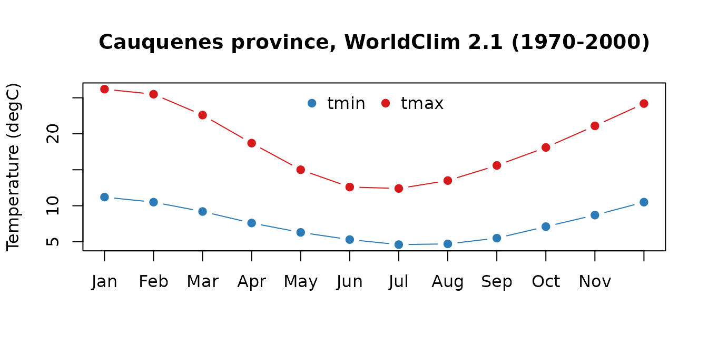
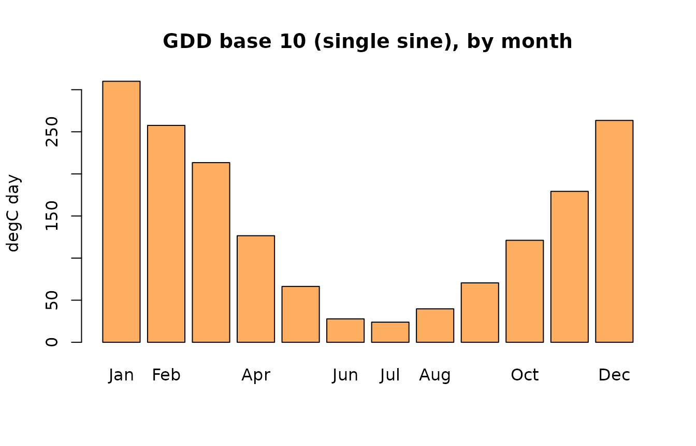
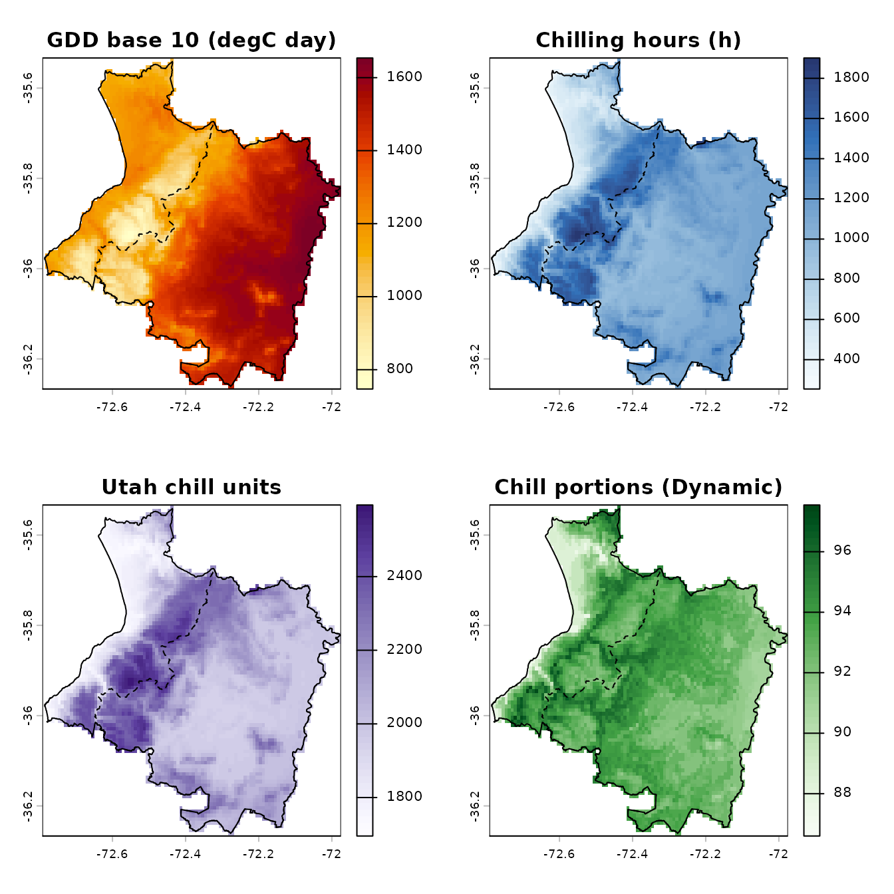
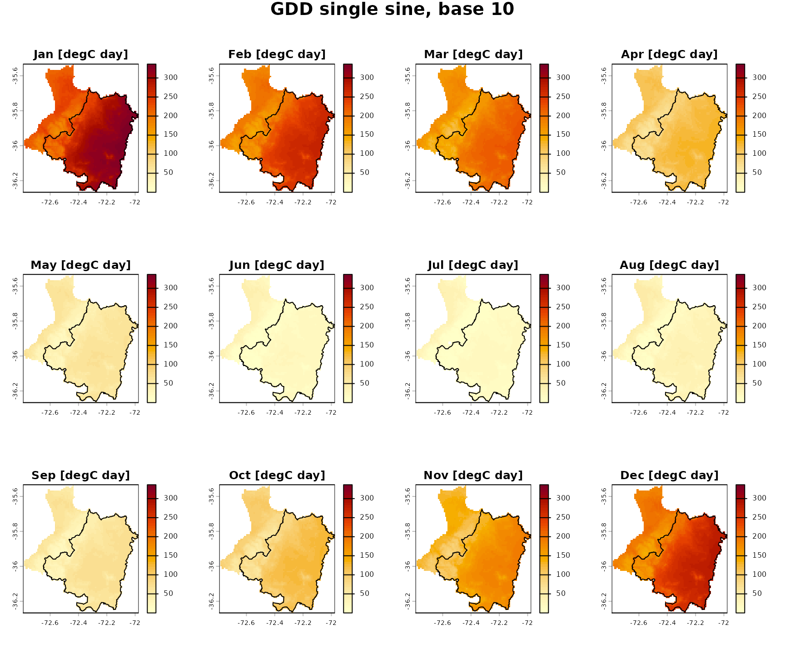
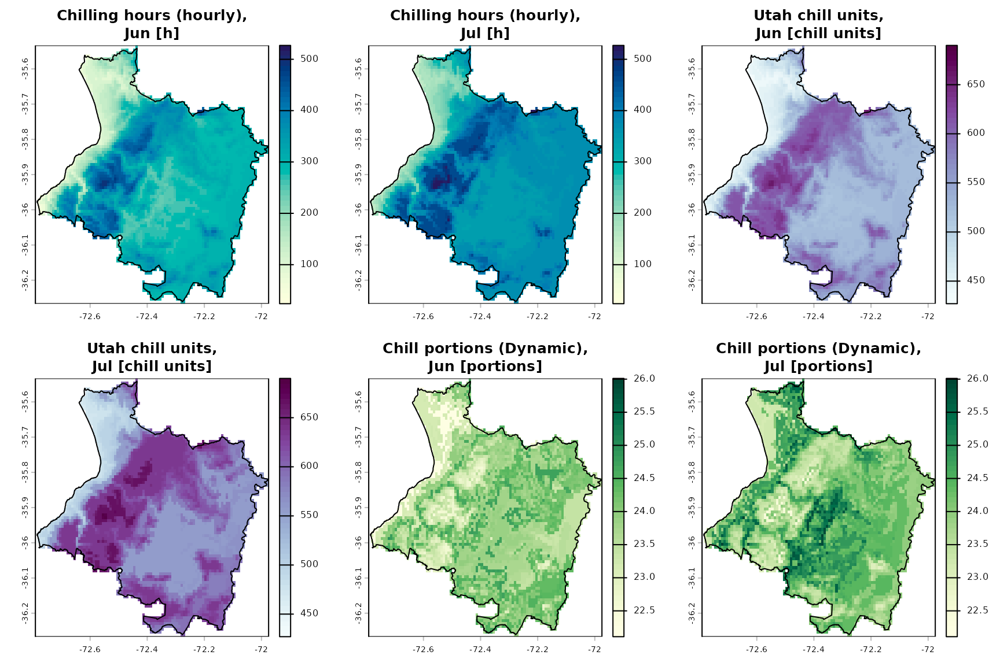
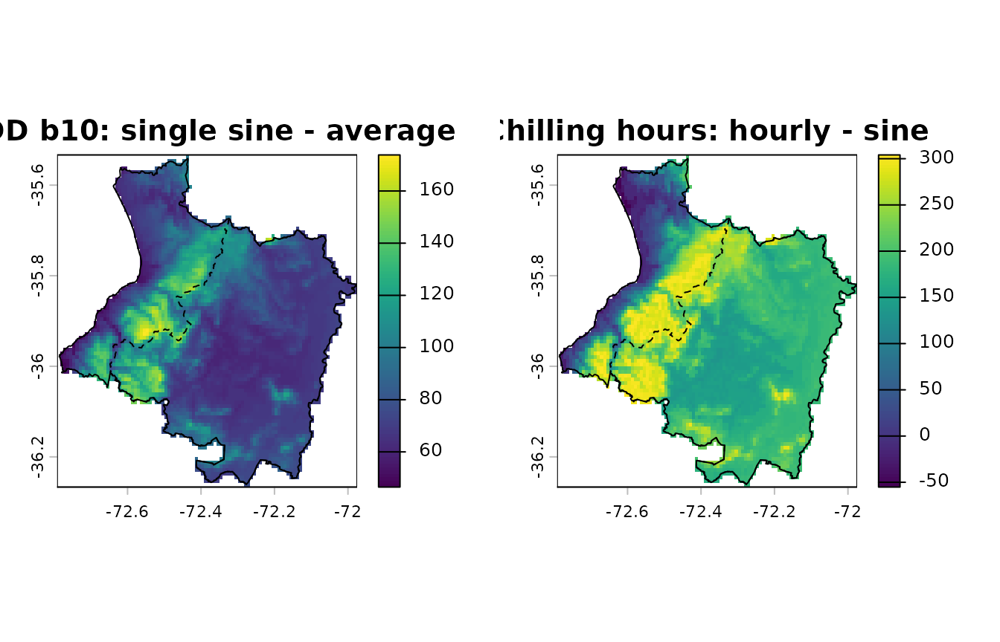

# Tutorial: Cauquenes (Maule, Chile) from WorldClim 2.1

This tutorial computes heat and chill indices for the province of
Cauquenes (Maule Region, Chile) from the WorldClim 2.1 monthly
climatology (1970-2000) at 30 arc-seconds (about 0.9 x 0.75 km). The
province spans the Coastal Range from the coast to the central valley,
so the indices vary widely over short distances. The steps follow
`examples/cauquenes/run.R`, which uses a 20 x 20 km window around the
town instead.

## 1. Study area

thermify includes the official boundaries of the commune and province of
Cauquenes from the 2023 Political and Administrative Division of Chile
(DPA 2023, SUBDERE).

``` r

library(thermify)   # also attaches terra
comuna    <- cauquenes_boundary("comuna", crs = "EPSG:4326")
provincia <- cauquenes_boundary("provincia", crs = "EPSG:4326")
data.frame(level = c(comuna$nivel, provincia$nivel),
           name = c(comuna$COMUNA, provincia$PROVINCIA),
           area_km2 = c(comuna$SUPERFICIE, provincia$SUPERFICIE))
#>       level      name area_km2
#> 1    comuna Cauquenes  2124.54
#> 2 provincia Cauquenes  3021.67
```

## 2. WorldClim 2.1 for the province only

[`worldclim_region()`](https://djwillichile.github.io/thermify/reference/worldclim_region.md)
reads only the part of the global 30” tiles that covers the polygon
(GDAL `/vsicurl/` range requests, under 1 MB here), caches it and masks
the cells outside the province:

``` r

tmin <- worldclim_region("tmin", provincia, path = "data", mask = TRUE)
tmax <- worldclim_region("tmax", provincia, path = "data", mask = TRUE)
```

``` r

tmin
#> class       : SpatRaster
#> size        : 88, 98, 12  (nrow, ncol, nlyr)
#> resolution  : 0.008333333, 0.008333333  (x, y)
#> extent      : -72.79167, -71.975, -36.26667, -35.53333  (xmin, xmax, ymin, ymax)
#> coord. ref. : lon/lat WGS 84 (EPSG:4326)
#> source      : wc2.1_30s_tmin_region_51b8bba0.tif
#> names       :  m01,  m02, m03, m04, m05, m06, ...
#> min values  :  8.8,  8.1, 6.9, 5.3,   4, 2.7, ...
#> max values  : 12.3, 11.5,  10, 8.9, 7.9, 7.2, ...
check_monthly_climate(tmin, tmax)
#>                        check                                           value
#> 1         layers tmin / tmax                                         12 / 12
#> 2  layer names (month order) m01,m02,m03,m04,m05,m06,m07,m08,m09,m10,m11,m12
#> 3                        CRS                                            4326
#> 4                 resolution                         0.00833333 x 0.00833333
#> 5                     extent        -72.79167, -71.975, -36.26667, -35.53333
#> 6              same geometry                                            TRUE
#> 7         value range (degC)                                       2 to 29.5
#> 8        cells / valid cells                                     8624 / 4554
#> 9          identical NA mask                                            TRUE
#> 10 tmin > tmax (cell-months)                                               0
#>      ok
#> 1  TRUE
#> 2  TRUE
#> 3  TRUE
#> 4  TRUE
#> 5  TRUE
#> 6  TRUE
#> 7  TRUE
#> 8  TRUE
#> 9  TRUE
#> 10 TRUE
```

The province is covered by 4554 valid 30” cells. With `touches = TRUE`
(the default) every cell touching the boundary is kept, so the cells add
up to slightly more than the official area; use `touches = FALSE` when
cell areas matter. The mean monthly climatology of the province:

``` r

clim <- data.frame(
  month = month.abb,
  tmin = round(unlist(global(tmin, "mean", na.rm = TRUE)), 1),
  tmax = round(unlist(global(tmax, "mean", na.rm = TRUE)), 1),
  row.names = NULL)
clim
#>    month tmin tmax
#> 1    Jan 11.2 26.2
#> 2    Feb 10.5 25.5
#> 3    Mar  9.2 22.6
#> 4    Apr  7.6 18.7
#> 5    May  6.3 15.0
#> 6    Jun  5.3 12.6
#> 7    Jul  4.6 12.4
#> 8    Aug  4.7 13.5
#> 9    Sep  5.5 15.6
#> 10   Oct  7.1 18.1
#> 11   Nov  8.7 21.1
#> 12   Dec 10.5 24.2
```

``` r

matplot(1:12, clim[, c("tmin", "tmax")], type = "b", pch = 19, lty = 1,
        col = c("#2c7bb6", "#d7191c"), xaxt = "n", xlab = "",
        ylab = "Temperature (degC)",
        main = "Cauquenes province, WorldClim 2.1 (1970-2000)")
axis(1, at = 1:12, labels = month.abb)
legend("top", c("tmin", "tmax"), col = c("#2c7bb6", "#d7191c"), pch = 19,
       horiz = TRUE, bty = "n")
```



## 3. One location: the town of Cauquenes

[`thermify()`](https://djwillichile.github.io/thermify/reference/thermify.md)
densifies the 12 monthly values of a cell to daily values with a
mean-preserving interpolation (`pchip_mp`), reconstructs hourly
temperatures (Linvill model) and accumulates the indices over the heat
season (1 September - 30 April) and the chill season (1 May - 31
August).

The tutorial uses the native R engine (`temporal = "native"`), which
reproduces tempify to within 1e-13 degC. With `reticulate` installed,
`temporal = "auto"` uses the
[tempify](https://github.com/djwillichile/tempify) Python package
instead; it is set up automatically the first time (see
[`install_tempify()`](https://djwillichile.github.io/thermify/reference/install_tempify.md)
and
[`vignette("tempify-integration")`](https://djwillichile.github.io/thermify/articles/tempify-integration.md)).

``` r

town <- vect(cbind(-72.3225, -35.9671), crs = "EPSG:4326")
tmin_town <- unlist(extract(tmin, town, ID = FALSE))
tmax_town <- unlist(extract(tmax, town, ID = FALSE))

res <- thermify(tmin_town, tmax_town, input = "monthly", latitude = -35.97,
                temporal = "native", interpolation = "pchip_mp",
                indices = c("gdd", "ch", "cu", "cp"),
                gdd_methods = c("average", "single_sine", "double_sine"),
                base = c(5, 10), ch_methods = c("sine", "hourly"))

season <- res$summary[res$summary$aggregation == "season",
                      c("key", "value", "units")]
season$value <- round(season$value, 1)
rownames(season) <- NULL
season
#>                    key  value       units
#> 1       gdd_average_b5 2690.4    degC day
#> 2      gdd_average_b10 1480.4    degC day
#> 3   gdd_single_sine_b5 2690.4    degC day
#> 4  gdd_single_sine_b10 1542.0    degC day
#> 5   gdd_double_sine_b5 2690.9    degC day
#> 6  gdd_double_sine_b10 1542.1    degC day
#> 7              ch_sine  827.3           h
#> 8            ch_hourly  970.0           h
#> 9              cu_utah 1944.5 chill units
#> 10          cp_dynamic   92.7    portions
```

Growing degree-days (base 10 degC) by month:

``` r

gdd <- res$summary[res$summary$key == "gdd_single_sine_b10" &
                     res$summary$aggregation %in% sprintf("m%02d", 1:12), ]
barplot(gdd$value, names.arg = month.abb, col = "#fdae61",
        ylab = "degC day", main = "GDD base 10 (single sine), by month")
```



Chill accumulation during the chill season:

``` r

d <- res$daily
chill <- d$month %in% 5:8
op <- par(mfrow = c(1, 3), mar = c(4, 4, 3, 1))
plot(d$date[chill], cumsum(d$ch_hourly[chill]), type = "l", lwd = 2,
     xlab = "", ylab = "h", main = "Chilling hours (0-7.2 degC)")
plot(d$date[chill], cumsum(d$cu_utah[chill]), type = "l", lwd = 2,
     xlab = "", ylab = "chill units", main = "Utah model")
plot(d$date[chill], cumsum(d$cp_dynamic[chill]), type = "l", lwd = 2,
     xlab = "", ylab = "portions", main = "Dynamic model")
```


``` r

par(op)
```

## 4. Indices for every cell

[`thermify_rast()`](https://djwillichile.github.io/thermify/reference/thermify_rast.md)
applies the same workflow to every cell, block by block, and writes one
file per index with layers `season`, `annual` and `m01` to `m12`.
Latitude is taken from each cell. Printing the result summarises the
indices, their units and layers:

``` r

maps <- thermify_rast(
  tmin, tmax, output_dir = file.path(tempdir(), "cauquenes-rasters"),
  temporal = "native", interpolation = "pchip_mp",
  indices = c("gdd", "ch", "cu", "cp"),
  gdd_methods = c("average", "single_sine"), base = 10,
  ch_methods = c("sine", "hourly"), progress = FALSE)
maps
#> <thermify_rast> 6 indices, 88 x 98 cells, 4554 valid
#> engine: native | interpolation: pchip_mp | reference year: 2023 
#>   gdd_average_b10          [degC day]     season annual m01 m02 m03 m04 m05 m06 m07 m08 m09 m10 m11 m12
#>   gdd_single_sine_b10      [degC day]     season annual m01 m02 m03 m04 m05 m06 m07 m08 m09 m10 m11 m12
#>   ch_sine                  [h]            season annual m01 m02 m03 m04 m05 m06 m07 m08 m09 m10 m11 m12
#>   ch_hourly                [h]            season annual m01 m02 m03 m04 m05 m06 m07 m08 m09 m10 m11 m12
#>   cu_utah                  [chill units]  season m01 m02 m03 m04 m05 m06 m07 m08 m09 m10 m11 m12
#>   cp_dynamic               [portions]     season m01 m02 m03 m04 m05 m06 m07 m08 m09 m10 m11 m12
#> files in: /tmp/Rtmpvma6H4/cauquenes-rasters
```

Spatial summary of the seasonal totals over the province:

``` r

stats <- do.call(rbind, lapply(names(maps), function(k) {
  v <- values(maps[[k]]$season, mat = FALSE)
  v <- v[!is.na(v)]
  data.frame(index = k, cells = length(v),
             mean = mean(v), min = min(v),
             p05 = unname(quantile(v, 0.05)), median = stats::median(v),
             p95 = unname(quantile(v, 0.95)), max = max(v))
}))
stats[, -(1:2)] <- round(stats[, -(1:2)], 1)
stats
#>                 index cells   mean    min    p05 median    p95    max
#> 1     gdd_average_b10  4554 1247.1  573.3  800.0 1280.9 1546.9 1583.4
#> 2 gdd_single_sine_b10  4554 1331.1  747.1  935.8 1360.1 1613.1 1653.9
#> 3             ch_sine  4554  942.9  305.5  553.3  934.8 1301.6 1624.2
#> 4           ch_hourly  4554 1117.1  254.0  558.0 1117.0 1599.0 1901.0
#> 5             cu_utah  4554 2087.3 1695.5 1789.0 2044.0 2414.5 2594.5
#> 6          cp_dynamic  4554   92.9   86.6   89.6   93.0   95.6   97.5
```

[`plot()`](https://rspatial.github.io/terra/reference/plot.html) draws
every index for the season, with titles, units and one palette per
family; `boundary` adds the province outline:

``` r

plot(maps, boundary = provincia)
```



### The annual cycle

`type = "monthly"` shows the twelve monthly layers of an index on a
common colour scale, here in a 3 x 4 grid with the commune outline:

``` r

plot(maps, variable = "gdd_single_sine_b10", type = "monthly",
     nrow = 3, ncol = 4, boundary = comuna)
```



and `variable` also accepts index families, for example the chill
indices in the coldest months:

``` r

plot(maps, variable = c("ch_hourly", "cu", "cp"), type = c("m06", "m07"),
     nrow = 2, ncol = 3, boundary = provincia)
```



## 5. Method differences

Estimating degree-days from the daily mean ignores the hours above the
base on days whose mean is below it. The difference with the single sine
method is largest where the nights are cold:

``` r

d_gdd <- maps$gdd_single_sine_b10$season - maps$gdd_average_b10$season
d_ch  <- maps$ch_hourly$season - maps$ch_sine$season
op <- par(mfrow = c(1, 2))
plot(d_gdd, main = "GDD b10: single sine - average")
lines(provincia); lines(comuna, lty = 2)
plot(d_ch, main = "Chilling hours: hourly - sine")
lines(provincia); lines(comuna, lty = 2)
```



``` r

par(op)
valid <- function(r) stats::na.omit(values(r, mat = FALSE))
round(rbind(gdd_sine_minus_average = summary(valid(d_gdd)),
            ch_hourly_minus_sine = summary(valid(d_ch))), 1)
#>                         Min. 1st Qu. Median  Mean 3rd Qu.  Max.
#> gdd_sine_minus_average  46.5    67.8   74.2  84.0    94.2 173.8
#> ch_hourly_minus_sine   -55.2   148.2  182.1 174.2   212.4 304.1
```

## Interpretation

- Values are climatological estimates for a reference 365-day calendar,
  not observations of any particular year.
- Two modelling layers (monthly to daily, daily to hourly) add
  uncertainty, especially to the non-linear chill indices.
- The tutorial checks computation and quantifies method differences; it
  does not validate any method against observations (see
  [`vignette("validation")`](https://djwillichile.github.io/thermify/articles/validation.md)).
