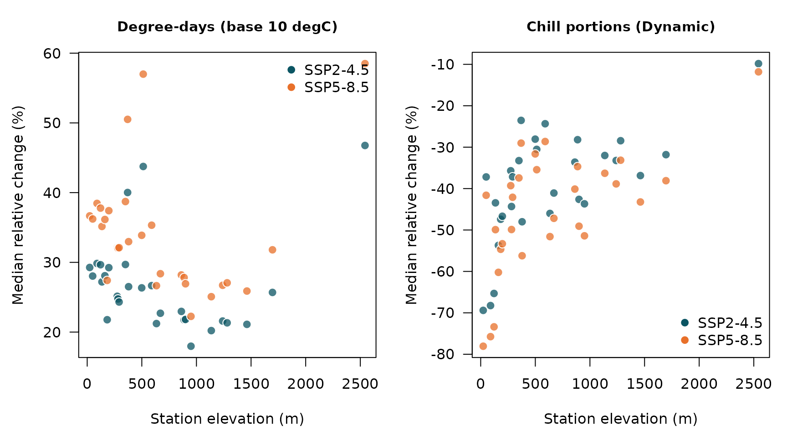
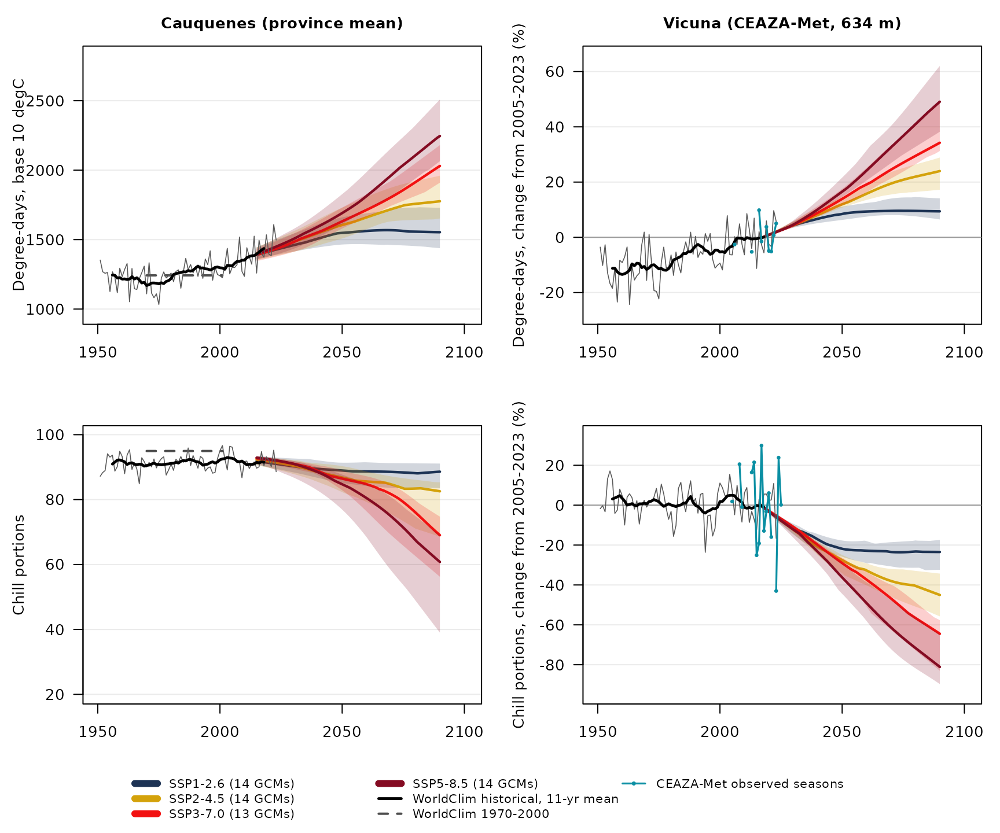

# Projected change of thermal indices: WorldClim CMIP6

How much would degree-days and winter chill change by mid-century? This
page uses the WorldClim 2.1 downscaled CMIP6 projections, read with
[`worldclim_future_region()`](https://djwillichile.github.io/thermify/reference/worldclim_future_region.md),
for **14 global climate models (GCMs)**, two scenarios (SSP2-4.5 and
SSP5-8.5) and the period **2041-2060**, against the WorldClim 1970-2000
baseline.

> **Read these numbers as changes, not as future values.** The
> validation with observed stations ([CEAZA-Met
> article](https://djwillichile.github.io/thermify/articles/validation-ceaza.md))
> showed that WorldClim and monthly climatologies have large errors for
> chill, so this page reports the **change** between the future and the
> baseline of the same data, where much of that error cancels. It also
> reports the spread between models: a single GCM can be far from the
> consensus.

Scripts: `data-raw/climate-change/`. Heat season 1 September - 30 April;
chill season 1 May - 31 August.

## Province of Cauquenes (Maule)

Indices computed with
[`thermify_rast()`](https://djwillichile.github.io/thermify/reference/thermify_rast.md)
from the monthly WorldClim surfaces (degree-days with the averaging
method; chill with the Linvill hourly reconstruction,
`ch_methods = "hourly"`).

| Scenario | Index | Baseline | Median change | Range of 14 GCMs |
|:---|:---|:---|:---|:---|
| SSP2-4.5 | Degree-days (base 10 degC) | 1247 degC day | +361 (+29 %) | +249 to +579 |
| SSP2-4.5 | Chilling hours (0-7.2 degC) | 1117 h | -542 (-49 %) | -828 to -310 |
| SSP2-4.5 | Utah chill units | 2087 units | -388 (-19 %) | -636 to -215 |
| SSP2-4.5 | Chill portions (Dynamic) | 93 portions | -7 (-8 %) | -14 to -3 |
| SSP5-8.5 | Degree-days (base 10 degC) | 1247 degC day | +450 (+36 %) | +334 to +726 |
| SSP5-8.5 | Chilling hours (0-7.2 degC) | 1117 h | -609 (-54 %) | -984 to -432 |
| SSP5-8.5 | Utah chill units | 2087 units | -474 (-23 %) | -908 to -322 |
| SSP5-8.5 | Chill portions (Dynamic) | 93 portions | -9 (-10 %) | -24 to -6 |

Province mean, 2041-2060 against 1970-2000. Baselines are WorldClim
values and inherit their errors; use the changes. {.table}

Median change across the 14 GCMs, 2041-2060. For degree-days, chilling
hours and Utah units all 14 models agree on the sign of the change in
every cell. For chill portions they do not everywhere: in the coldest
fifth of the province (winter mean temperature of about 6-8 degrees C)
the median change is close to zero, sometimes slightly positive, and the
models split; in the rest every model projects a loss, larger where
winters are milder. This is expected from the Dynamic model, in which
chill accumulates most efficiently at moderate temperatures: a cold site
can lose little chill, or even gain some, from a moderate warming.

### The choice of chill model changes the conclusion

Under the same warming, **chilling hours fall by about half, but chill
portions fall by less than a tenth**. Chilling hours count every hour
between 0 and 7.2 degrees C and ignore that slightly warmer hours still
contribute to chill accumulation; the Dynamic model, which describes
chill accumulation and its reversal by heat, responds much less to a
moderate warming. Studies that report future chill only as chilling
hours therefore tend to overstate the loss (Luedeling et al. 2011). For
planning, **prefer chill portions**, and report chilling hours only for
comparison with older literature.

## CEAZA-Met stations (north-central Chile): delta method

At 29 of the 30 stations of the
[validation](https://djwillichile.github.io/thermify/articles/validation-ceaza.md),
each model’s monthly change at the station’s WorldClim cell is applied
to **every hour of the station’s observed record**: the shift goes from
the change of the minimum at the daily minimum to the change of the
maximum at the daily maximum. The indices are then computed from the
modified hourly series, season by season, exactly as the reference of
the validation. This keeps the observed day-to-day and year-to-year
variability, and the present-day baseline is the observed index.

The change applied is each model’s change **from the period of the
record to 2041-2060**, not from 1970-2000: the records cover about
2004-2025 and already contain part of the warming since 1970-2000, which
would otherwise be counted twice. WorldClim gives each model’s change
from 1970-2000 (centred on 1985) to each future period; the change at
the record’s midpoint (about 2015) is interpolated linearly between 1985
and the model’s 2021-2040 change and subtracted. The model’s own
trajectory is used, not the observed warming, because the two differ: in
the semi-arid north the historical series shows almost no winter warming
since 1970-2000, while the models warm winters, and mixing both would
exaggerate the projected loss of chill. Punta de Choros is excluded: the
station is on the shoreline and its WorldClim cell is sea (no data), so
there is no model change to apply.

A simpler variant, adding the change to the station’s monthly
climatology, is **not** used: monthly climatologies lose the cold
nights, give zero chill portions at several interior stations that
actually accumulate 27-31 portions per season, and make marginal sites
lose all their chill under any warming.

Each point is a station and scenario (median of the 14 GCMs).

| Scenario | Index | Median over stations | Stations losing all chill |
|:---|:---|:---|:---|
| SSP2-4.5 | Degree-days (base 10 degC) | +13 % | \- |
| SSP2-4.5 | Chilling hours (0-7.2 degC) | -30 % | 0 |
| SSP2-4.5 | Utah chill units | -37 % | 2 |
| SSP2-4.5 | Chill portions (Dynamic) | -19 % | 0 |
| SSP5-8.5 | Degree-days (base 10 degC) | +19 % | \- |
| SSP5-8.5 | Chilling hours (0-7.2 degC) | -38 % | 1 |
| SSP5-8.5 | Utah chill units | -49 % | 2 |
| SSP5-8.5 | Chill portions (Dynamic) | -25 % | 0 |

Median relative change over the stations (each station: median of 14
GCMs). Median warming at the stations from the record period to
2041-2060: SSP2-4.5 +1.0 degC (Tmin) and +1.0 degC (Tmax); SSP5-8.5 +1.3
and +1.4 degC. {.table}

Because the changes are measured from the period of the records (about
2015), the warming applied at the stations, about +1.0 degrees C under
SSP2-4.5 and +1.4 degrees C under SSP5-8.5, is smaller than in the
Cauquenes maps, which are measured from 1970-2000. Even so, the
semi-arid north loses a larger share of its chill: the median station
loses about **a fifth of its chill portions** (19 % under SSP2-4.5, 25 %
under SSP5-8.5), against less than a tenth in Cauquenes for a larger
warming. Under SSP2-4.5 the losses are largest on the coast (about 37 %
at Coquimbo and Caleta El Toro and 31-33 % at La Serena, below 170 m)
and smallest at the highest station (4 % at Los Molles, 2,543 m). No
station loses all its chill portions. Chilling hours fall by about a
third at the median station and disappear only at Caleta El Toro under
SSP5-8.5, where the observed baseline is below 2 hours per season. Utah
units can be negative because the Utah model subtracts chill for warm
hours, so their relative changes are unstable near zero and exceed -100
% at some stations; use them with care in mild climates.

## Through time: historical series and four scenarios

The figure below follows degree-days and chill portions through time, in
the style of the CMIP6 projection plots of Brunner et al. (2020), for
four scenarios (SSP1-2.6, SSP2-4.5, SSP3-7.0 and SSP5-8.5) and the four
20-year periods of WorldClim (2021-2040 to 2081-2100). WorldClim
provides 20-year means, not yearly projections. Each model’s trajectory
is therefore drawn through its four period means, placed at the centre
of each period (2030, 2050, 2070 and 2090), from a common starting point
(the WorldClim 1970-2000 value, centred on 1985, for the province; the
observed mean, centred on the record’s midpoint, for the station), with
a monotone spline; the curves end in 2090, the centre of the last
period. The line is the median of the models’ trajectories and the
shaded band the likely range (17th to 83rd percentile, 66 % of the
models), year by year. The curves describe the climate around each year,
not a forecast of individual years: unlike yearly model runs, they carry
no year-to-year variability, which the historical and observed series
show.

- **Cauquenes (left).** The historical series 1951-2023 comes from the
  WorldClim 2.1 historical monthly weather data (CRU-TS 4.09 downscaled
  with WorldClim, 2.5 arc-minutes), and the projections from the CMIP6
  surfaces; all values are computed with the same monthly method from
  the province-mean temperatures, so the past and the projections are
  directly comparable. As monthly-based estimates, their absolute values
  carry the biases measured in the validation.
- **Vicuna (right; CEAZA-Met, Elqui valley, 634 m).** The historical
  series 1951-2023 at the station’s WorldClim cell (same monthly method
  as for the province), the observed seasons of the station’s hourly
  record, and projections with the delta method on that record. Each
  model’s change is taken from the period of the record (centred on
  about 2015) to each future period, so that the warming already
  contained in the record is not counted twice. All three are shown as
  **relative change from 2005-2023**, the period of the record: the
  historical series and the observed record differ in level (about 76
  chill portions per season at the 2.5-arc-minute cell with the monthly
  method, against 37 observed at the station; the cell averages about
  4.6 km of terrain around a station on the valley floor, and the
  monthly method has its own biases), so only their changes and
  variability are comparable.

What the figure shows:

- **Degree-days have already risen.** In Cauquenes the historical series
  rises from 1189 degree-days in 1971-1980 to 1413 in 2011-2020 (+19 %),
  and the 2021-2040 projections continue that trend. After mid-century
  the scenarios separate: by 2081-2100 the median reaches 1553
  degree-days under SSP1-2.6 and 2252 under SSP5-8.5.

- **Chill has not yet changed in Cauquenes, but it will under high
  emissions.** Chill portions have stayed near 91 per season since 1951.
  Under SSP1-2.6 they hardly change (89 in 2081-2100); under SSP5-8.5
  they fall to 60 by 2081-2100.

- **The semi-arid north is far more exposed.** At Vicuna the observed
  mean is 37 chill portions per season; by 2081-2100 the median is 28
  under SSP1-2.6 and 7 under SSP5-8.5, too few for most temperate fruit
  trees. The scenario chosen matters far more than the model: the bands
  of SSP1-2.6 and SSP5-8.5 do not overlap after 2060.

- **Monthly data hide the year-to-year variability of chill.** At Vicuna
  the historical series and the observed seasons agree on degree-days
  (year-to-year standard deviation of about 6 % and 5 % in 2005-2023),
  but the observed chill portions vary far more than the monthly series
  (21 % against 8 %): monthly means smooth out the cold spells that
  drive chill accumulation. The historical series also shows that
  degree-days at Vicuna have risen by about 12 % since 1971-1980, while
  chill has not changed.

Two details are worth reading correctly. The WorldClim 1970-2000 value
of chill portions (95) is higher than the mean of the historical seasons
over the same years (91), while for degree-days both agree: the Dynamic
model is non-linear, and the index of a mean climate is not the mean of
the indices of individual years. The projections are built on the
WorldClim climatology, so compare them with the dashed line rather than
with single historical seasons. Second, the interpolation between period
centres is a smooth guide, not a model result in its own right: only the
values at 2030, 2050, 2070 and 2090 come from the projections.

## Limitations

- **Changes, not forecasts.** WorldClim future surfaces add each model’s
  change to the 1970-2000 baseline; the results describe a climate
  centred on 2041-2060, not any particular year.
- **Monthly data in Cauquenes.** The province maps are computed from
  monthly climatologies, which lose day-to-day variability and bias
  absolute chill values (about -25 % for chilling hours in the
  validation); changes are less affected but not immune. The station
  analysis avoids this by using the observed hourly records, but assumes
  that day-to-day and diurnal variability stay as they are.
- **Model spread.** The table shows the range of 14 GCMs; some (for
  example CanESM5 and UKESM1-0-LL) warm more than most models. The
  median is the summary to use.
- **Baseline period.** The Cauquenes maps and table measure changes from
  1970-2000, part of which has already happened. The station analysis
  measures them from the period of each record, interpolating each
  model’s trajectory between 1985 and 2021-2040; this assumes that the
  model’s warming is roughly linear over those decades.
- **Validation.** Chill estimates have been validated only in semi-arid
  north-central Chile; the central-south is pending.

## References

Luedeling, E., Girvetz, E. H., Semenov, M. A., & Brown, P. H. (2011).
Climate change affects winter chill for temperate fruit and nut trees.
*PLoS ONE*, 6(5), e20155. <https://doi.org/10.1371/journal.pone.0020155>

Brunner, L., Pendergrass, A. G., Lehner, F., Merrifield, A. L., Lorenz,
R., & Knutti, R. (2020). Reduced global warming from CMIP6 projections
when weighting models by performance and independence. *Earth System
Dynamics*, 11(4), 995-1012. <https://doi.org/10.5194/esd-11-995-2020>

Fick, S. E., & Hijmans, R. J. (2017). WorldClim 2: new 1-km spatial
resolution climate surfaces for global land areas. *International
Journal of Climatology*, 37(12), 4302-4315.
<https://doi.org/10.1002/joc.5086>

Harris, I., Osborn, T. J., Jones, P., & Lister, D. (2020). Version 4 of
the CRU TS monthly high-resolution gridded multivariate climate dataset.
*Scientific Data*, 7, 109. <https://doi.org/10.1038/s41597-020-0453-3>
