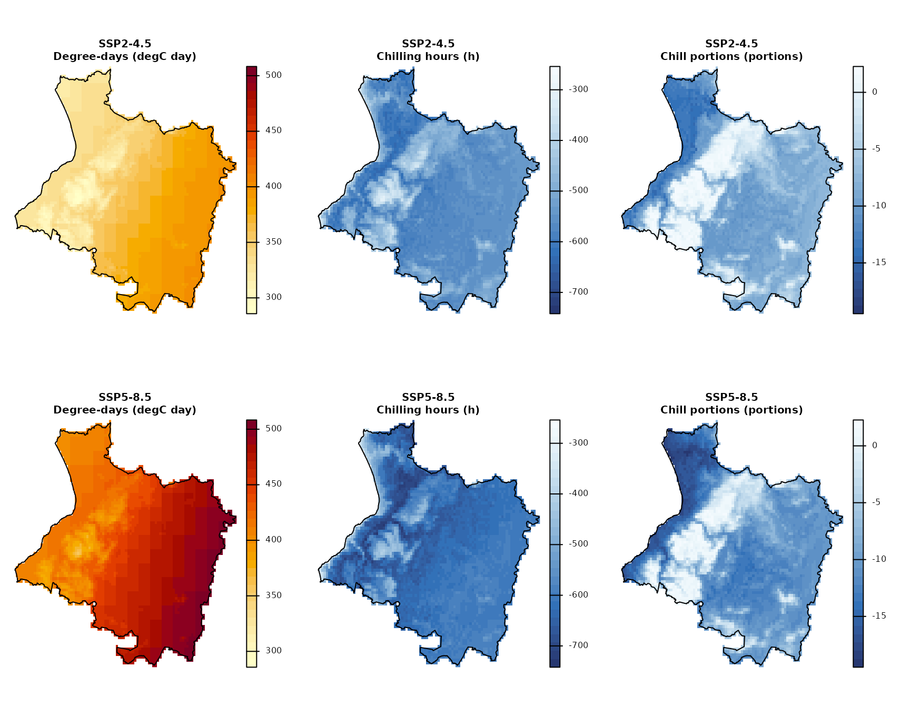

# Projected change of thermal indices: WorldClim CMIP6

How much would degree-days and winter chill change by mid-century? This
page uses the WorldClim 2.1 downscaled CMIP6 projections, read with
[`worldclim_future_region()`](https://djwillichile.github.io/thermify/reference/worldclim_future_region.md),
for **14 global climate models (GCMs)**, two scenarios (SSP2-4.5 and
SSP5-8.5) and the period **2041-2060**, against the WorldClim 1970-2000
baseline.

> **Read these numbers as changes, not as future values.** The
> validation with observed stations ([CEAZA-Met
> article](https://djwillichile.github.io/thermify/articles/validation-ceaza.md))
> showed that WorldClim and monthly climatologies have large errors for
> chill, so this page reports the **change** between the future and the
> baseline of the same data, where much of that error cancels. It also
> reports the spread between models: a single GCM can be far from the
> consensus.

Scripts: `data-raw/climate-change/`. Heat season 1 September - 30 April;
chill season 1 May - 31 August.

## Province of Cauquenes (Maule)

Indices computed with
[`thermify_rast()`](https://djwillichile.github.io/thermify/reference/thermify_rast.md)
from the monthly WorldClim surfaces (degree-days with the averaging
method; chill with the Linvill hourly reconstruction,
`ch_methods = "hourly"`).

| Scenario | Index | Baseline | Median change | Range of 14 GCMs |
|:---|:---|:---|:---|:---|
| SSP2-4.5 | Degree-days (base 10 degC) | 1247 degC day | +361 (+29 %) | +249 to +579 |
| SSP2-4.5 | Chilling hours (0-7.2 degC) | 1117 h | -542 (-49 %) | -828 to -310 |
| SSP2-4.5 | Utah chill units | 2087 units | -388 (-19 %) | -636 to -215 |
| SSP2-4.5 | Chill portions (Dynamic) | 93 portions | -7 (-8 %) | -14 to -3 |
| SSP5-8.5 | Degree-days (base 10 degC) | 1247 degC day | +450 (+36 %) | +334 to +726 |
| SSP5-8.5 | Chilling hours (0-7.2 degC) | 1117 h | -609 (-54 %) | -984 to -432 |
| SSP5-8.5 | Utah chill units | 2087 units | -474 (-23 %) | -908 to -322 |
| SSP5-8.5 | Chill portions (Dynamic) | 93 portions | -9 (-10 %) | -24 to -6 |

Province mean, 2041-2060 against 1970-2000. Baselines are WorldClim
values and inherit their errors; use the changes. {.table}

Median change across the 14 GCMs, 2041-2060. For degree-days, chilling
hours and Utah units all 14 models agree on the sign of the change in
every cell. For chill portions they do not everywhere: in the coldest
fifth of the province (winter mean temperature of about 6-8 degrees C)
the median change is close to zero, sometimes slightly positive, and the
models split; in the rest every model projects a loss, larger where
winters are milder. This is expected from the Dynamic model, in which
chill accumulates most efficiently at moderate temperatures: a cold site
can lose little chill, or even gain some, from a moderate warming.

### The choice of chill model changes the conclusion

Under the same warming, **chilling hours fall by about half, but chill
portions fall by less than a tenth**. Chilling hours count every hour
between 0 and 7.2 degrees C and ignore that slightly warmer hours still
contribute to chill accumulation; the Dynamic model, which describes
chill accumulation and its reversal by heat, responds much less to a
moderate warming. Studies that report future chill only as chilling
hours therefore tend to overstate the loss (Luedeling et al. 2011). For
planning, **prefer chill portions**, and report chilling hours only for
comparison with older literature.

## CEAZA-Met stations (north-central Chile): delta method

At 29 of the 30 stations of the
[validation](https://djwillichile.github.io/thermify/articles/validation-ceaza.md),
each model’s monthly change at the station’s WorldClim cell (future
minus 1970-2000) is applied to **every hour of the station’s observed
record**: the shift goes from the change of the minimum at the daily
minimum to the change of the maximum at the daily maximum. The indices
are then computed from the modified hourly series, season by season,
exactly as the reference of the validation. This keeps the observed
day-to-day and year-to-year variability, and the present-day baseline is
the observed index. Punta de Choros is excluded: the station is on the
shoreline and its WorldClim cell is sea (no data), so there is no model
change to apply.

A simpler variant, adding the change to the station’s monthly
climatology, is **not** used: monthly climatologies lose the cold
nights, give zero chill portions at several interior stations that
actually accumulate 27-31 portions per season, and make marginal sites
lose all their chill under any warming.

Each point is a station and scenario (median of the 14 GCMs).

| Scenario | Index | Median over stations | Stations losing all chill |
|:---|:---|:---|:---|
| SSP2-4.5 | Degree-days (base 10 degC) | +26 % | \- |
| SSP2-4.5 | Chilling hours (0-7.2 degC) | -54 % | 2 |
| SSP2-4.5 | Utah chill units | -70 % | 7 |
| SSP2-4.5 | Chill portions (Dynamic) | -37 % | 0 |
| SSP5-8.5 | Degree-days (base 10 degC) | +32 % | \- |
| SSP5-8.5 | Chilling hours (0-7.2 degC) | -60 % | 3 |
| SSP5-8.5 | Utah chill units | -81 % | 9 |
| SSP5-8.5 | Chill portions (Dynamic) | -42 % | 0 |

Median relative change over the stations (each station: median of 14
GCMs). Median warming at the stations: SSP2-4.5 +1.9 degC (Tmin) and
+1.9 degC (Tmax); SSP5-8.5 +2.2 and +2.4 degC. {.table}

With a similar warming at the stations (about +1.9 degrees C under
SSP2-4.5), the semi-arid north loses a much larger share of its chill
than Cauquenes: the median station loses about **a third of its chill
portions** (37 % under SSP2-4.5, 42 % under SSP5-8.5), against less than
a tenth in Cauquenes. The losses are largest on the coast (about two
thirds at Caleta El Toro, La Serena and Coquimbo, below 130 m) and
smallest at the highest station (about 10 % at Los Molles, 2,543 m). No
station loses all its chill portions. Chilling hours, which already fall
by about half at the median station, disappear at the coastal stations
whose baseline is only 2-13 hours per season (two stations under
SSP2-4.5, three under SSP5-8.5). Utah units can be negative because the
Utah model subtracts chill for warm hours, so their relative changes are
unstable near zero and exceed -100 % at some stations; use them with
care in mild climates.

## Limitations

- **Changes, not forecasts.** WorldClim future surfaces add each model’s
  change to the 1970-2000 baseline; the results describe a climate
  centred on 2041-2060, not any particular year.
- **Monthly data in Cauquenes.** The province maps are computed from
  monthly climatologies, which lose day-to-day variability and bias
  absolute chill values (about -25 % for chilling hours in the
  validation); changes are less affected but not immune. The station
  analysis avoids this by using the observed hourly records, but assumes
  that day-to-day and diurnal variability stay as they are.
- **Model spread.** The table shows the range of 14 GCMs; some (for
  example CanESM5 and UKESM1-0-LL) warm more than most models. The
  median is the summary to use.
- **Baseline period.** The baseline is 1970-2000; part of the projected
  change has already happened.
- **Validation.** Chill estimates have been validated only in semi-arid
  north-central Chile; the central-south is pending.

## References

Luedeling, E., Girvetz, E. H., Semenov, M. A., & Brown, P. H. (2011).
Climate change affects winter chill for temperate fruit and nut trees.
*PLoS ONE*, 6(5), e20155. <https://doi.org/10.1371/journal.pone.0020155>

Fick, S. E., & Hijmans, R. J. (2017). WorldClim 2: new 1-km spatial
resolution climate surfaces for global land areas. *International
Journal of Climatology*, 37(12), 4302-4315.
<https://doi.org/10.1002/joc.5086>
