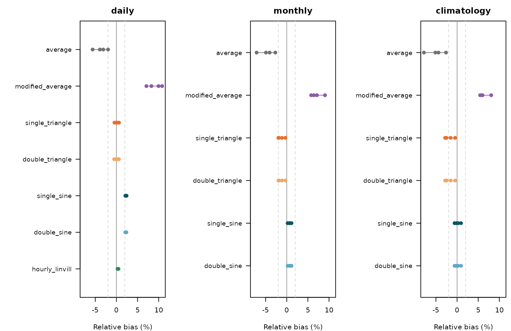
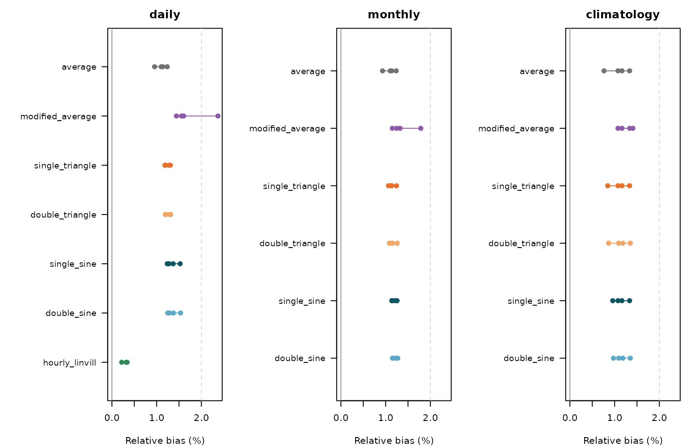
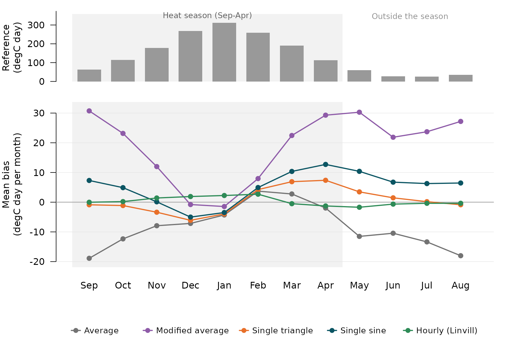

# Degree-day methods compared on synthetic temperatures

> **These temperatures are synthetic.** They are simulated from real
> monthly normals (WorldClim 2.1 at 30 arc-seconds) at four sites in the
> Maule Region, but the daily and hourly values are generated. The
> experiment measures how much error each method adds under known,
> controlled conditions. It does not replace validation against observed
> station records, which is in progress
> ([`vignette("validation")`](https://djwillichile.github.io/thermify/articles/validation.md)).

## Question

Most agroclimatic studies do not have hourly temperature. They have
daily extremes from a station, or monthly climatologies such as
WorldClim. How much error does each degree-day method add in each case?

## Design

The script `data-raw/gdd-synthetic/run.R` reproduces every number on
this page (seed 20261119, about 10 seconds).

1.  **Sites.** Four WorldClim 2.1 cells in the Maule Region: coast
    (Chanco area, 69 m), coastal dryland (Cauquenes, 157 m), central
    valley (Talca area, 98 m) and Andean foothills (480 m).
2.  **Daily extremes.** The monthly normals densified with `pchip_mp`,
    plus day-to-day anomalies (first-order autoregressive, lag-1
    correlation 0.7, standard deviation 2.8 degrees C for the maximum
    and 2.0 for the minimum, correlated shocks) and a yearly anomaly. 31
    years per site.
3.  **Hourly “truth”.** The Parton & Logan (1981) diurnal model: a sine
    by day with the maximum lagging solar noon, an exponential decay at
    night towards the next minimum, plus autocorrelated hourly noise.
    This shape is deliberately *not* the sine, triangle or Linvill
    profile assumed by the methods under test, so none of them matches
    the generator by construction.
4.  **Reference.** Degree-hours / 24 from the hourly series.
5.  **Estimates at three levels**, as in
    [`vignette("validation")`](https://djwillichile.github.io/thermify/articles/validation.md):
    - **daily**: the daily minimum and maximum of the hourly series with
      each daily method, and the Linvill hourly reconstruction;
    - **monthly**: each year’s monthly means of those extremes,
      densified with `pchip_mp`, then each daily method;
    - **climatology**: the 30-year mean monthly extremes, densified once
      and compared with every year.
6.  **Metrics** for the heat season (1 September - 30 April), 30 seasons
    per site: bias, mean absolute error and relative bias.

The simulated monthly means stay within 0.4 degrees C of the WorldClim
normals; the daily maximum occurs around 13:00 and the minimum around
06:00.

## Results: base 10 degrees C

Each method has three rows, one per level of information; each symbol is
a site and the line spans the four sites. The grey band marks ±2 %.
Methods are ordered by their bias with daily extremes.

| method           | coast | dryland | valley | foothills |
|:-----------------|:------|:--------|:-------|:----------|
| average          | -3.9  | -3.1    | -2.0   | -5.6      |
| modified_average | +10.0 | +8.3    | +7.1   | +10.8     |
| single_triangle  | +0.0  | +0.2    | +0.6   | -0.5      |
| double_triangle  | -0.0  | +0.2    | +0.6   | -0.5      |
| single_sine      | +2.4  | +2.1    | +2.2   | +2.3      |
| double_sine      | +2.4  | +2.1    | +2.1   | +2.2      |
| hourly_linvill   | +0.3  | +0.4    | +0.4   | +0.5      |

Relative bias (%) of the season total, base 10 degrees C, daily level.
{.table}

| method           | coast | dryland | valley | foothills |
|:-----------------|:------|:--------|:-------|:----------|
| average          | -4.9  | -4.1    | -2.7   | -7.1      |
| modified_average | +7.1  | +6.4    | +5.8   | +9.0      |
| single_triangle  | -1.9  | -1.1    | -0.3   | -2.0      |
| double_triangle  | -1.8  | -1.1    | -0.3   | -2.0      |
| single_sine      | +0.2  | +0.7    | +1.1   | +0.7      |
| double_sine      | +0.2  | +0.7    | +1.1   | +0.7      |

Relative bias (%) of the season total, base 10 degrees C, monthly level.
{.table}

### What the numbers say

- **Daily extremes.** The triangle methods and the Linvill
  reconstruction stay within about 1 %. The sine methods overestimate by
  about 2 %, because a symmetric sine spends as much time near the
  maximum as near the minimum, while real nights are long and cool. The
  averaging method underestimates by 2-6 %, most in the foothills, where
  the minimum is often below the base (Jensen’s inequality). The
  **modified average overestimates by 7-11 %**: raising the minimum to
  the base gives the whole cool part of the day the base temperature.
- **Monthly means.** Densified monthly values have no day-to-day
  variability, so cool days with the minimum below the base disappear.
  That lowers every estimate and, for the sine methods, happens to
  offset their positive shape bias: they end up within about 1 %. **This
  is a compensation of two errors, not evidence that the sine is the
  right shape**, and it depends on how variable the real weather is.
- **Climatology.** One climatological year compared with 30 different
  years adds interannual variability: the bias is similar to the monthly
  level, but the mean absolute error grows to about 90 degrees C day for
  every method (table below), larger than most differences between
  methods.

| method           | daily | monthly | climatology |
|:-----------------|------:|--------:|------------:|
| average          |    47 |      61 |          97 |
| modified_average |   124 |      96 |         122 |
| single_triangle  |     6 |      17 |          87 |
| double_triangle  |     6 |      17 |          87 |
| single_sine      |    32 |      10 |          90 |
| double_sine      |    31 |      10 |          90 |
| hourly_linvill   |     7 |      \- |          \- |

Mean absolute error (degrees C day) of the season total at the dryland
site, base 10 degrees C. Mean season total: about 1495 degrees C day.
{.table}

## Results: base 5 degrees C

With a base of 5 degrees C the minimum is rarely below the base and the
daily methods differ little. They overestimate by about 1-1.5 % (up to
2.4 % for the modified average in the foothills), except the Linvill
reconstruction (0.2-0.3 %): with long cool nights the daily mid-range
$`(T_{min} + T_{max}) / 2`$ is above the true daily mean, and only an
asymmetric diurnal profile corrects it.

## Seasonal pattern

Dryland site, daily extremes, base 10 degrees C; mean of 30 years. Top:
monthly degree-days of the hourly reference. Bottom: mean bias of each
method. The shaded months form the heat season used in the tables above.
The double sine and double triangle methods are omitted because they are
almost identical to the single ones.

The methods agree most in midsummer (December-February), when most of
the day is above the base. From March to November the minimum is usually
below 10 degrees C while the maximum is above it, and the methods
diverge: the averaging method underestimates and the modified average
overestimates by 20-30 degrees C day per month, while the triangle
methods stay within about 7 and the Linvill reconstruction within 3
degrees C day. The top panel puts these numbers in context: from May to
August the reference total is only 26-59 degrees C day per month, so the
same absolute bias is a much larger relative error than in summer.

## Practical guidance

- **With daily extremes**, use a triangle method or the hourly
  reconstruction (`gdd_methods = "hourly"` in
  [`thermify()`](https://djwillichile.github.io/thermify/reference/thermify.md)).
  Prefer them over the simple average when minimum temperatures fall
  below the base.
- **With monthly climatologies**, the method matters less than the loss
  of day-to-day variability. Report the method used and treat
  differences of a few percent between methods as within the
  uncertainty.
- **The modified average** reproduces a published convention (for
  example the “86/50” rule for maize). Use it to match that convention,
  not as an estimate of the integrated heat of the day.

## Limitations

- The generator is one plausible climate and diurnal shape. Different
  day-to-day variability, cloudiness or diurnal shapes change the size,
  and possibly the sign, of the compensations described above.
- The daily minimum and maximum come from hourly means, as in many
  station networks; extremes from sub-hourly records are slightly wider.
- Only the horizontal cutoff and an upper threshold of 30 degrees C were
  evaluated; results with upper thresholds are in the data file and are
  similar to those without one at these sites.
- These conclusions must be confirmed with observed hourly records from
  station networks (issue \#3).

## Data

The tables behind this page are in `vignettes/articles/data/`
(`gdd-synthetic-season.csv`, `gdd-synthetic-monthly.csv`).

## References

Parton, W. J., & Logan, J. A. (1981). A model for diurnal variation in
soil and air temperature. *Agricultural Meteorology*, 23, 205-216.
<https://doi.org/10.1016/0002-1571(81)90105-9>

McMaster, G. S., & Wilhelm, W. W. (1997). Growing degree-days: one
equation, two interpretations. *Agricultural and Forest Meteorology*,
87(4), 291-300. <https://doi.org/10.1016/S0168-1923(97)00027-0>
