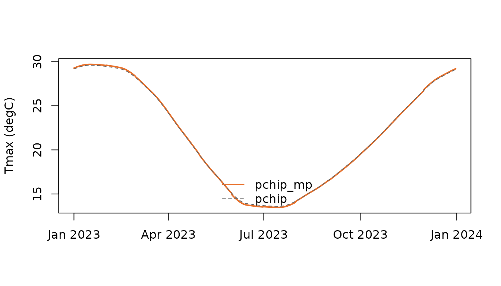

# Monthly to daily: tempify integration

## Why densify?

Thermal indices are non-linear in temperature. Applying them to monthly
means biases the result; densifying the monthly normals to daily values
first reduces (but does not remove) that bias, because daily weather
variability is still absent.

## Engines

[`densify_monthly()`](https://djwillichile.github.io/thermify/reference/densify_monthly.md)
offers two engines:

- `engine = "tempify"`: the Python package
  [tempify](https://github.com/djwillichile/tempify) through
  `reticulate` (reference implementation, six methods). Data cross the
  R/Python boundary as raw float64 buffers, which avoids any dependence
  on reticulate’s NumPy ABI support. The tempify version and git commit
  are stored in the provenance.
- `engine = "native"`: a pure R implementation of `"pchip"` and
  `"pchip_mp"` that reproduces tempify to within 1e-13 degC (tested for
  365 and 366 days).

### Installing tempify

tempify is a Python package, so R cannot install it as a dependency.
thermify sets it up for you in one of three ways, tried in this order
when the package is loaded:

1.  **Your own Python.** If you chose one (`RETICULATE_PYTHON`,
    [`reticulate::use_virtualenv()`](https://rstudio.github.io/reticulate/reference/use_python.html)
    and similar), it is used as is.
2.  **A persistent environment.**
    [`install_tempify()`](https://djwillichile.github.io/thermify/reference/install_tempify.md)
    creates the virtual environment `"r-thermify"` once; thermify uses
    it in every later session.
3.  **Automatic.** With `reticulate` (\>= 1.41), thermify declares
    tempify with
    [`reticulate::py_require()`](https://rstudio.github.io/reticulate/reference/py_require.html).
    The first time the tempify engine is needed, reticulate builds and
    caches a Python environment with it (about one minute and 100 MB,
    once); later sessions reuse the cache.

``` r

install.packages("reticulate")   # >= 1.41 for the automatic route
library(thermify)
tempify_available()              # first call prepares the environment
tempify_version()                # version and git commit, for provenance

install_tempify()                # alternative: persistent "r-thermify" env
options(thermify.tempify_auto = FALSE)   # opt out, before library(thermify)
# In scripts (Rscript) the automatic route is off; enable it with
# Sys.setenv(THERMIFY_TEMPIFY_AUTO = "true") before library(thermify).
```

Installing tempify from GitHub needs `git`. Without Python or tempify,
`temporal = "auto"` falls back to the native engine.

## The `pchip_mp` algorithm

1.  Monthly values are placed at mid-month (day
    `(days_in_month + 1) %/% 2`).
2.  A cyclic PCHIP interpolant (two padding nodes on each side) is
    evaluated for every day.
3.  Each month’s residual (monthly value minus mean of its daily values)
    is added uniformly to its days. One pass reproduces the monthly mean
    exactly.

``` r

tmin <- c(11.4, 11.1, 9.2, 6.8, 5.3, 3.9, 3.1, 3.6, 4.6, 6.3, 8.4, 10.3)
tmax <- c(29.6, 29.2, 26.5, 21.9, 17.2, 13.9, 13.6, 15.3, 17.9, 21.2,
          24.9, 28.2)
mp <- densify_monthly(tmin, tmax, engine = "native", method = "pchip_mp")
pc <- densify_monthly(tmin, tmax, engine = "native", method = "pchip")
plot(mp$dates, mp$tmax[1, ], type = "l", col = "#E8702A", lwd = 2,
     ylab = "Tmax (degC)", xlab = "")
lines(pc$dates, pc$tmax[1, ], col = "grey40", lty = 2)
legend("bottom", c("pchip_mp", "pchip"), col = c("#E8702A", "grey40"),
       lty = 1:2, bty = "n")
```



``` r

rbind(pchip = densify_diagnostics(pc$tmax, tmax, pc$dates),
      pchip_mp = densify_diagnostics(mp$tmax, tmax, mp$dates))
#>          max_abs_mean_error max_boundary_step max_interior_step
#> pchip             0.1584262         0.1641311         0.1666196
#> pchip_mp          0.0000000         0.2729854         0.1666196
```

Plain PCHIP passes through the mid-month values but does not conserve
monthly means. The uniform correction of `pchip_mp` conserves them
exactly but introduces small steps at month boundaries, reported by
[`densify_diagnostics()`](https://djwillichile.github.io/thermify/reference/densify_diagnostics.md).
A smoother mean-preserving scheme (full Rymes & Myers 2001 neighbour
smoothing) would remove those steps; this is a candidate improvement for
tempify.

## Physical consistency

`tmin` and `tmax` are densified independently. thermify checks every day
for $`T_{min} \le T_{max}`$ and stops if the check fails
(`consistency = "check"`). The alternative `consistency = "mean_range"`
densifies the daily mean and the diurnal range instead; because the
back-transformation is linear, monthly means of both extremes are still
preserved exactly. Extremes are never swapped or clipped silently.
