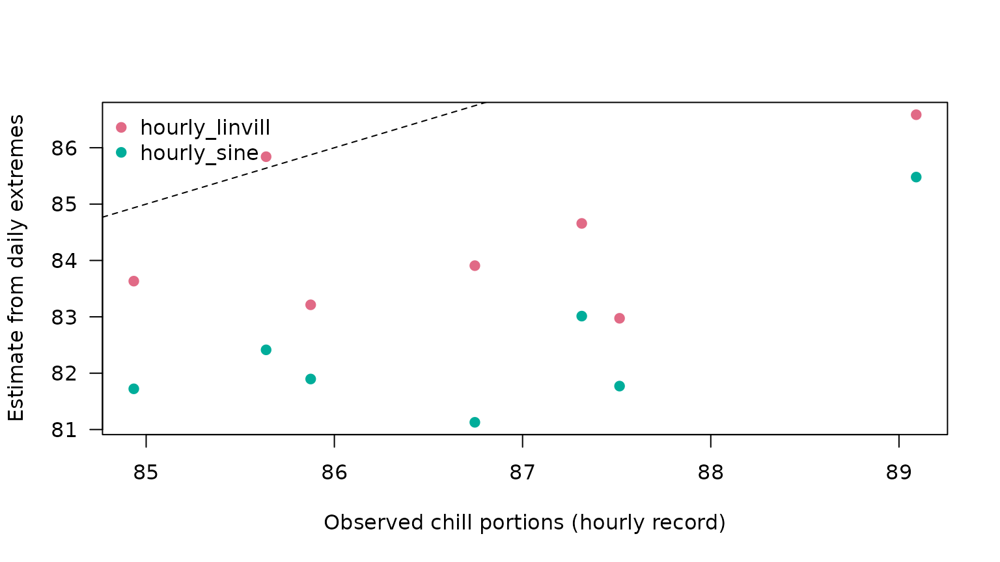

# How to validate thermify with your own stations

thermify estimates degree-days and winter chill from daily or monthly
temperatures. How good are those estimates where **you** work? The only
way to know is to compare them with indices computed from **observed
hourly temperature**. This guide shows how to do that with your own
stations, step by step, and how to share the results so that they help
other users.

So far the methods have been validated only in semi-arid north-central
Chile ([CEAZA-Met
validation](https://djwillichile.github.io/thermify/articles/validation-ceaza.md)).
Validations in other climates are very welcome: see the [call for
validations](https://github.com/djwillichile/thermify/issues) on GitHub.

## What the validation measures

For each station and season,
[`validate_station()`](https://djwillichile.github.io/thermify/reference/validate_station.md)
computes the **observed** index from the hourly record and compares it
with the **estimates** that thermify produces from progressively less
information:

| Level | Input to thermify | Error it adds |
|----|----|----|
| `daily` | daily minimum and maximum of the same station | the diurnal model (how hours are reconstructed from two daily values) |
| `monthly` | the station’s own monthly climatology | loss of day-to-day and year-to-year variability |
| `gridded` (optional) | a gridded climatology, e.g. the WorldClim cell | spatial interpolation and the difference between normal periods |

Comparing the levels tells you **where** the error comes from, not only
how large it is.

## What you need

- **Hourly air temperature** (degrees C) from one or more stations.
  Ideally at least **5 complete seasons**, because one season says
  little about systematic errors.
- For each station: **name, latitude, longitude, elevation**, the data
  source and how it must be cited.
- The **time zone** of the timestamps, and whether each value marks the
  **start or the end** of its hour.

## Step 1: read your data

Most networks deliver a CSV with a date-time column and a temperature
column. The two most common pitfalls are the **time zone** and
**daylight saving time**: thermify expects local *standard* time,
without clock changes. Use a fixed-offset zone (`"Etc/GMT+4"` is UTC-4,
that is, Chilean standard time; note the inverted sign in these names)
or convert from UTC.

``` r

obs <- read.csv("my_station.csv")
obs$time <- as.POSIXct(obs$datetime, format = "%Y-%m-%d %H:%M",
                       tz = "Etc/GMT+4")
# If each value marks the END of its hour, shift it to the start:
# obs$time <- obs$time - 3600
summary(obs$temperature)       # check units and implausible values
```

To make this guide reproducible without distributing third-party data,
the rest of the examples use a **synthetic station** built with known
diurnal cycles and random noise. Its numbers only illustrate the
workflow; they are not a validation result.

``` r

set.seed(42)
dates <- seq(as.Date("2016-01-01"), as.Date("2022-12-31"), by = "day")
doy <- as.integer(format(dates, "%j"))
tmin <- 7 + 5 * cos(2 * pi * (doy - 20) / 365) + rnorm(length(dates), 0, 2)
tmax <- tmin + 12 + 3 * cos(2 * pi * (doy - 20) / 365) +
  rnorm(length(dates), 0, 1.5)
hourly <- hourly_temperatures(tmin, tmax, "linvill", latitude = -33,
                              doy = doy) +
  rnorm(24 * length(dates), 0, 0.7)        # measurement noise
obs <- data.frame(
  time = as.POSIXct(paste(rep(format(dates), each = 24),
                          sprintf("%02d:00", rep(0:23, length(dates)))),
                    tz = "Etc/GMT+4"),
  temperature = as.vector(t(hourly)))
obs$temperature[sample(nrow(obs), 300)] <- NA          # isolated gaps
obs$temperature[20000:20030] <- NA                     # a long gap
head(obs)
#>                  time temperature
#> 1 2016-01-01 00:00:00    15.21702
#> 2 2016-01-01 01:00:00    15.97984
#> 3 2016-01-01 02:00:00    16.15406
#> 4 2016-01-01 03:00:00    15.16599
#> 5 2016-01-01 04:00:00    15.22171
#> 6 2016-01-01 05:00:00    15.92227
```

## Step 2: quality control

[`prepare_station_hourly()`](https://djwillichile.github.io/thermify/reference/prepare_station_hourly.md)
puts the record on a regular hourly grid, fills short gaps by linear
interpolation and flags the days that remain incomplete. Only complete
days, and therefore complete seasons, are used later.

``` r

st <- prepare_station_hourly(obs$time, obs$temperature, max_gap = 2,
                             range = c(-40, 55))
st
#> <station_hourly> 2016-01-01 to 2022-12-31
#>   days: 2557 (2555 valid, 99.9%)
#>   hours: 61037 observed, 300 filled (gaps <= 2 h), 31 missing
```

- `max_gap = 2` fills gaps of up to two hours. Longer gaps leave the day
  invalid: do not increase it much, because interpolating long gaps
  smooths exactly the cold or hot spells the indices depend on.
- `range` removes physically implausible values before filling.
- Report the counts of filled and missing hours with your results.

## Step 3: define the seasons

The defaults follow the **southern hemisphere**: chill season 1 May to
31 August and heat season 1 September to 30 April. In the **northern
hemisphere**, or for crops with other phenology, set them explicitly,
for example `chill_period = c("11-01", "02-28")` and
`heat_period = c("04-01", "10-31")`. Windows that cross the new year are
supported; each season is labelled by the year in which it starts.

## Step 4: run the validation

``` r

v <- validate_station(st, latitude = -33,
                      indices = c("gdd", "ch", "cu", "cp"), base = 10,
                      chill_period = c("05-01", "08-31"),
                      heat_period = c("09-01", "04-30"))
v
#> <thermify_validation> 7 season(s) evaluated, 3 excluded
#>  index   level          method n    bias    mae   rmse rel_bias    r
#>    gdd   daily         average 5  -45.15  45.15  45.24    -3.15 0.99
#>    gdd   daily     single_sine 5   58.28  58.28  58.50     4.07 0.97
#>    gdd   daily single_triangle 5   22.47  22.47  23.05     1.57 0.97
#>    gdd   daily     double_sine 5   56.05  56.05  56.30     3.91 0.97
#>    gdd   daily double_triangle 5   19.55  19.55  20.32     1.37 0.97
#>    gdd   daily  hourly_linvill 5   23.36  23.36  24.15     1.63 0.96
#>    gdd   daily     hourly_sine 5   55.47  55.47  55.74     3.87 0.97
#>     ch   daily            sine 7 -200.59 200.59 201.92   -13.44 0.99
#>     ch   daily  hourly_linvill 7   40.71  40.71  44.19     2.73 0.97
#>     ch   daily     hourly_sine 7 -194.43 194.43 195.76   -13.02 0.98
#>     cu   daily  hourly_linvill 7  -77.21  77.21  77.62    -3.91 0.98
#>     cu   daily     hourly_sine 7 -240.07 240.07 240.53   -12.17 0.92
#>     cp   daily  hourly_linvill 7   -2.33   2.39   2.69    -2.68 0.44
#>     cp   daily     hourly_sine 7   -4.24   4.24   4.35    -4.89 0.72
#>    gdd monthly         average 5  -73.95  73.95  76.97    -5.16   NA
#>    gdd monthly     single_sine 5   27.44  27.46  34.77     1.92   NA
#>    gdd monthly single_triangle 5   -7.52  19.22  22.65    -0.53   NA
#>    gdd monthly     double_sine 5   27.58  27.58  34.89     1.93   NA
#>    gdd monthly double_triangle 5   -7.33  19.10  22.58    -0.51   NA
#>    gdd monthly  hourly_linvill 5   -3.80  17.75  21.70    -0.27   NA
#>     ch monthly            sine 7 -156.67 156.67 167.80   -10.49   NA
#>     ch monthly  hourly_linvill 7   98.14  98.14 115.08     6.57   NA
#>     cu monthly  hourly_linvill 7  121.50 121.50 126.78     6.16   NA
#>     cp monthly  hourly_linvill 7    0.99   1.38   1.63     1.15   NA
#>    gdd monthly     hourly_sine 5   27.62  27.62  34.91     1.93   NA
#>     ch monthly     hourly_sine 7 -159.86 159.86 170.78   -10.71   NA
#>     cu monthly     hourly_sine 7  -45.50  50.21  58.15    -2.31   NA
#>     cp monthly     hourly_sine 7   -1.03   1.27   1.65    -1.19   NA
```

To include the **gridded** level, pass the 12 monthly mean minimum and
maximum temperatures of the grid cell that contains the station. For
WorldClim 2.1:

``` r

pt <- terra::vect(data.frame(lon = -71.0, lat = -33.0),
                  geom = c("lon", "lat"), crs = "EPSG:4326")
region <- terra::ext(terra::buffer(pt, 2000))
cell <- function(r) as.vector(as.matrix(terra::extract(r, pt, ID = FALSE)))
wc <- list(tmin = cell(worldclim_region("tmin", region, tempdir(),
                                        mask = FALSE)),
           tmax = cell(worldclim_region("tmax", region, tempdir(),
                                        mask = FALSE)))
v <- validate_station(st, latitude = -33, gridded = wc)
```

The synthetic record covers 2016-2022: all 7 chill seasons are
evaluated, but only 5 heat seasons (`n` in the table). The heat seasons
cut by the start or the end of the record (2015 and 2022) and the one
that contains the 31-hour gap (2017, which leaves two days invalid) are
excluded and listed in `v$excluded`:

``` r

v$excluded
#>   index season            reason
#> 1   gdd   2015 incomplete window
#> 2   gdd   2017  2 invalid day(s)
#> 3   gdd   2022 incomplete window
```

## Step 5: read the results

The object has four parts:

- `v$metrics`: one row per index, level and method, with `n` (seasons),
  `bias` (estimate minus observed), `mae`, `rmse`, `rel_bias` (bias as a
  percentage of the observed mean) and `r` (correlation across seasons);
- `v$seasons`: the estimate and the observed value for every season;
- `v$excluded`: the seasons that were not evaluated, and why;
- `v$quality`: the gap-filling counts.

``` r

m <- v$metrics
d <- m[m$level == "daily", c("index", "method", "n", "bias", "rel_bias", "mae")]
d[4:6] <- lapply(d[4:6], round, 1)
d
#>    index          method n   bias rel_bias   mae
#> 1    gdd         average 5  -45.1     -3.2  45.1
#> 2    gdd     single_sine 5   58.3      4.1  58.3
#> 3    gdd single_triangle 5   22.5      1.6  22.5
#> 4    gdd     double_sine 5   56.0      3.9  56.0
#> 5    gdd double_triangle 5   19.6      1.4  19.6
#> 6    gdd  hourly_linvill 5   23.4      1.6  23.4
#> 7    gdd     hourly_sine 5   55.5      3.9  55.5
#> 8     ch            sine 7 -200.6    -13.4 200.6
#> 9     ch  hourly_linvill 7   40.7      2.7  40.7
#> 10    ch     hourly_sine 7 -194.4    -13.0 194.4
#> 11    cu  hourly_linvill 7  -77.2     -3.9  77.2
#> 12    cu     hourly_sine 7 -240.1    -12.2 240.1
#> 13    cp  hourly_linvill 7   -2.3     -2.7   2.4
#> 14    cp     hourly_sine 7   -4.2     -4.9   4.2
```

A plot of estimates against observations, season by season, often says
more than the table:

``` r

s <- v$seasons[v$seasons$level == "daily" & v$seasons$index == "cp", ]
methods <- unique(s$method)
cols <- grDevices::hcl.colors(length(methods), "Dark 3")
plot(s$observed, s$estimate, pch = 19, col = cols[match(s$method, methods)],
     xlab = "Observed chill portions (hourly record)",
     ylab = "Estimate from daily extremes", las = 1)
abline(0, 1, lty = 2)
legend("topleft", legend = methods, col = cols, pch = 19, bty = "n")
```



### How to interpret them

- **Relative bias** is the most comparable number across sites. A few
  percent is small next to the year-to-year variability of the indices.
- **Utah units** can be close to zero or negative, so their relative
  bias is not reported (`NA`); use the absolute bias and MAE instead.
- At the `monthly` and `gridded` levels a single climatological estimate
  is compared with every season: the error includes the year-to-year
  variability, and correlation is not defined.
- Daily minima taken from hourly records can fall in the evening when
  the following night is colder; that is part of the error being
  measured, not a problem in the data.

## Several stations

Run the same steps for each station and stack the results. The CEAZA-Met
scripts in
[`data-raw/validation-ceaza/`](https://github.com/djwillichile/thermify/tree/main/data-raw/validation-ceaza)
are a complete, adaptable example: screening, download with a local
cache, validation and figures.

``` r

stations <- read.csv("stations.csv")        # code, name, lat, lon, elevation
results <- lapply(seq_len(nrow(stations)), function(i) {
  obs <- read_my_station(stations$code[i])  # your own reader
  st <- prepare_station_hourly(obs$time, obs$temperature)
  v <- validate_station(st, latitude = stations$lat[i])
  cbind(station = stations$code[i], v$seasons)
})
seasons <- do.call(rbind, results)

# Metrics pooled over all stations, by index, level and method
pooled <- do.call(rbind, lapply(
  split(seasons, seasons[c("index", "level", "method")], drop = TRUE),
  function(d) cbind(d[1, c("index", "level", "method")],
                    validation_metrics(d$estimate, d$observed))))
```

With several stations you can also estimate weights for an ensemble of
degree-day methods (experimental) with
[`gdd_ensemble_weights()`](https://djwillichile.github.io/thermify/reference/gdd_ensemble_weights.md),
which assesses them by leaving one station out at a time.

## Share your results

Validations in other climates are the most useful contribution to
thermify. To share yours, open an issue or comment on the [call for
validations](https://github.com/djwillichile/thermify/issues) with:

1.  the stations (name, coordinates, elevation, period, data source and
    its citation);
2.  `v$metrics` and, if possible, `v$seasons` for each station (only
    derived results: the hourly records stay with you or the data
    provider);
3.  the numbers of filled and missing hours (`v$quality`);
4.  the versions used: `packageVersion("thermify")` and
    [`sessionInfo()`](https://rdrr.io/r/utils/sessionInfo.html).

Every contribution is acknowledged by name in the validation article and
in `NEWS.md`, with the citation the data provider requires.
