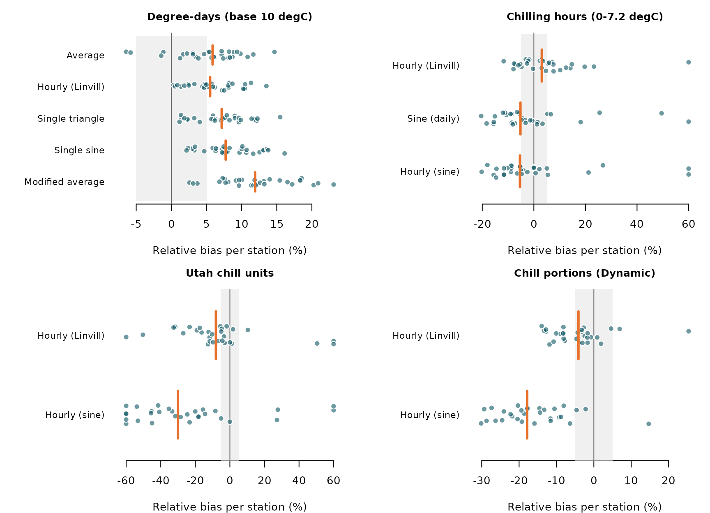
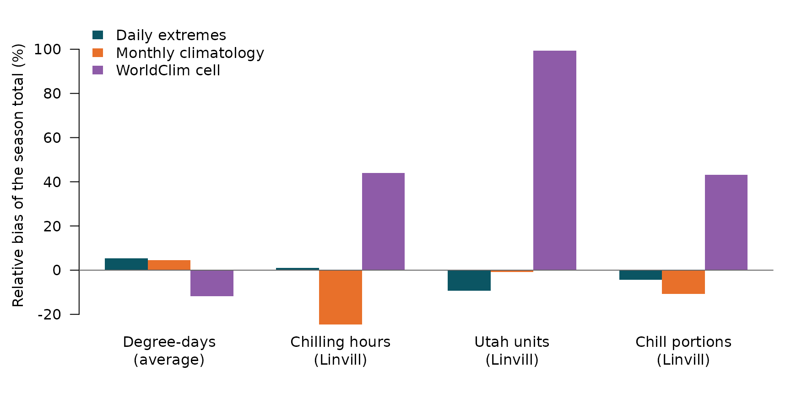
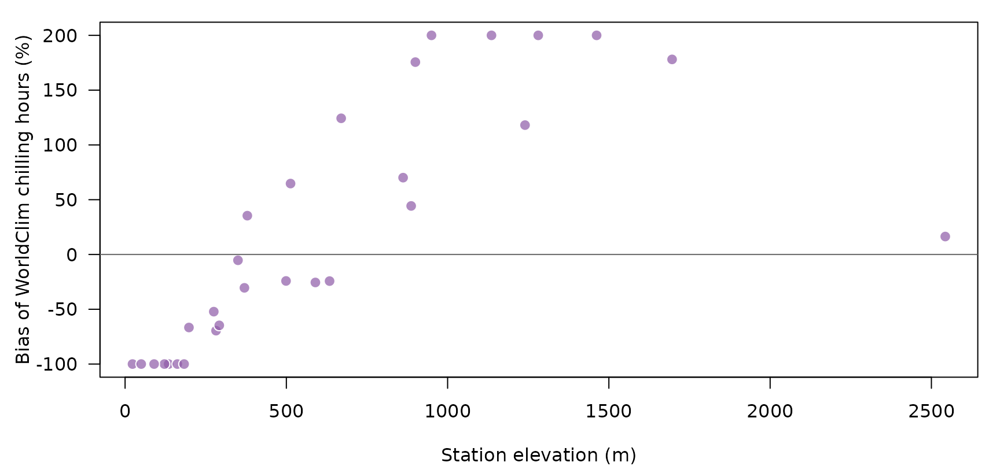

# Validation with observed hourly temperature: CEAZA-Met network

This page compares thermify estimates with indices computed from
**observed hourly air temperature** at 30 stations of the CEAZA-Met
network in north-central Chile. It is the first empirical validation of
the package
([`vignette("validation")`](https://djwillichile.github.io/thermify/articles/validation.md)
describes the protocol).

Data: Centro de Estudios Avanzados en Zonas Áridas (CEAZA),
[www.ceazamet.cl](https://www.ceazamet.cl), 2026. The hourly records are
not redistributed; this page uses seasonal totals derived from them.
Scripts: `data-raw/validation-ceaza/`.

## Stations and design

- 30 of the 53 CEAZA-Met stations with an air temperature sensor have at
  least 5 complete heat and chill seasons: 29 in the Coquimbo region and
  1 in Atacama, latitude 29.1-32.1 degrees S, elevation 7-2,543 m,
  2004-2025.
- **Reference**: each index computed directly from the observed hourly
  series (hourly means, local standard time).
- **Estimates** at three levels of information:
  - **daily**: the station’s own daily minimum and maximum, with each
    daily method and with the hourly reconstructions (Linvill, sine);
  - **monthly**: the station’s monthly climatology, densified with
    `pchip_mp`;
  - **gridded**: the WorldClim 2.1 30” cell of the station (1970-2000).
- Seasons: heat 1 September - 30 April (264 seasons), chill 1 May - 31
  August (313 seasons). Seasons with a gap longer than 2 hours are
  excluded.

## Pooled results from daily extremes

| Index                       | Method           | Seasons | Relative bias |   MAE |
|:----------------------------|:-----------------|--------:|:--------------|------:|
| Degree-days (base 10 degC)  | Average          |     264 | +5.4 %        | 100.7 |
| Degree-days (base 10 degC)  | Hourly (Linvill) |     264 | +6.0 %        |  97.0 |
| Degree-days (base 10 degC)  | Single triangle  |     264 | +7.2 %        | 116.6 |
| Degree-days (base 10 degC)  | Double triangle  |     264 | +7.2 %        | 117.2 |
| Degree-days (base 10 degC)  | Single sine      |     264 | +8.4 %        | 135.2 |
| Degree-days (base 10 degC)  | Hourly (sine)    |     264 | +8.4 %        | 135.6 |
| Degree-days (base 10 degC)  | Double sine      |     264 | +8.4 %        | 135.7 |
| Degree-days (base 10 degC)  | Modified average |     264 | +12.2 %       | 196.5 |
| Chilling hours (0-7.2 degC) | Hourly (Linvill) |     313 | +1.0 %        |  29.5 |
| Chilling hours (0-7.2 degC) | Sine (daily)     |     313 | -9.4 %        |  52.3 |
| Chilling hours (0-7.2 degC) | Hourly (sine)    |     313 | -9.4 %        |  52.4 |
| Utah chill units            | Hourly (Linvill) |     313 | -9.3 %        | 106.9 |
| Utah chill units            | Hourly (sine)    |     313 | -43.6 %       | 317.7 |
| Chill portions (Dynamic)    | Hourly (Linvill) |     313 | -4.3 %        |   3.7 |
| Chill portions (Dynamic)    | Hourly (sine)    |     313 | -16.3 %       |   8.8 |

Bias and mean absolute error (MAE, in the units of each index) of the
season total, pooled over 30 stations. Methods ordered by absolute bias
within each index. {.table}

- **Degree-days: every method overestimates.** The averaging method
  (+5.4 %) and the Linvill reconstruction (+6.0 %, lowest MAE) are the
  closest; the methods that assume a symmetric day (triangle +7.2 %,
  sine +8.4 %) overestimate more, and the modified average most (+12.2
  %). Double and single variants differ by only about 0.03 percentage
  points over a season.
- **Chill: the Linvill reconstruction is clearly the best**: chilling
  hours +1.0 %, chill portions -4.3 %, Utah units -9.3 %, against -9 %,
  -16 % and -44 % with the sine.

Why degree-days are overestimated: in this semi-arid climate the night
is long and cool and the warm peak is short, so the daily mid-range
(T_(min) + T_(max)) / 2 is above the true daily mean (by 0.9 degrees C
at Illapel). The synthetic experiment ([Degree-day methods compared on
synthetic
temperatures](https://djwillichile.github.io/thermify/articles/gdd-synthetic.md))
assumed a less skewed day and did not reproduce this bias.

## Station by station

Each point is one station (daily extremes); the orange bar is the
median; the grey band marks ±5 %. Values beyond ±60 % are drawn at the
edge. A few coastal stations accumulate very few chilling hours, so
their relative errors are large even when the absolute errors are small.

## Monthly climatologies and WorldClim

- **Monthly climatologies lose the cold nights.** Densified monthly
  values have no day-to-day variability, so chilling hours are
  underestimated by about 25 %. Utah units are almost unbiased on
  average (-0.9 % with Linvill), but with a much larger error per
  season.
- **WorldClim cells are the least reliable here**, and the pooled bias
  hides two opposite errors (figure below). For chilling hours, the
  WorldClim cell gives **no chilling hours at all at 7 of the 8 stations
  below 200 m**, although some of them record 400-500 hours per season,
  and it **overestimates them 1.4 to 4.3 times at the 10 stations
  between 650 and 1,700 m**.

Each point is one station; values above 200 % are drawn at 200 %. The
pattern is consistent with cold-air drainage, which makes low valley
bottoms colder at night than an interpolated surface predicts, and with
warm thermal belts on mid-elevation slopes, but this analysis does not
prove it. The reference periods also differ (1970-2000 normals against
seasons of 2004-2025, a period of warming), and that effect is not
separated either.

## Ensembles

All daily degree-day methods overestimate at these stations, so the bias
is shared by every member. Stacking, Bayesian model averaging and Akaike
weights all put the whole weight on the averaging method, and the
cross-validated error equals that of the averaging method: **an ensemble
cannot remove a bias that all of its members share**.

| Scheme   | Member with weight | Weight | CV RMSE (degC day) | CV bias (degC day) |
|:---------|:-------------------|-------:|-------------------:|-------------------:|
| stacking | Average            |      1 |            117.695 |              87.62 |
| bma      | Average            |      1 |            117.695 |              87.62 |
| akaike   | Average            |      1 |            117.695 |              87.62 |

## What this means in practice

For semi-arid climates like north-central Chile:

- **Degree-days from daily extremes**: use the averaging method or the
  Linvill reconstruction (`gdd_methods = "hourly"` in
  [`thermify()`](https://djwillichile.github.io/thermify/reference/thermify.md)),
  and expect an overestimate of about 5-6 %. Avoid the modified average
  except to reproduce a published convention.
- **Chill from daily extremes**: use the Linvill reconstruction
  (`hourly_method = "linvill"`, the default) and avoid the sine,
  especially for Utah units. Utah units and chill portions always use
  the hourly reconstruction. For chilling hours,
  [`thermify()`](https://djwillichile.github.io/thermify/reference/thermify.md)
  and
  [`thermify_rast()`](https://djwillichile.github.io/thermify/reference/thermify_rast.md)
  count on the hourly reconstruction by default
  (`ch_methods = "hourly"`, since thermify 0.5.0); the analytical
  `ch_methods = "sine"`, the default in earlier versions, underestimates
  them (-9 % here).
- **Monthly climatologies**: chilling hours are underestimated by about
  a quarter; report them as approximate.
- **WorldClim**: treat values in mountainous terrain with great caution
  and, when possible, calibrate them with local stations.

## Limitations

- Arid and semi-arid sites only. The central-south of Chile (INIA
  agrometeorological network, Maule, Ñuble and O’Higgins) has not been
  validated yet, and the conclusions may change in more humid climates.
- Hourly means, not instantaneous or sub-hourly values, are the
  reference.
- One base temperature (10 degrees C), no upper threshold; season
  totals, not daily or weekly sums.
